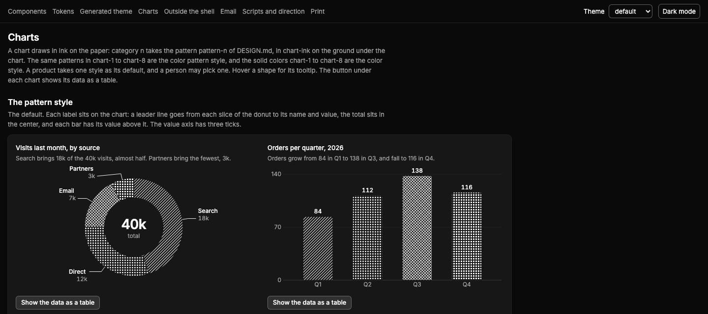

# STACK

STACK is the shared base that a set of web products build from. It holds the design file `DESIGN.md` and the CSS that a product imports. It also holds the stack choices, a decision record for each choice, and the architecture of each platform. The design system and the stack choices cover the whole of a web app and the admin area of a website. They do not cover the public pages of a website, because each site gets its own design and chooses its own stack. When a website runs its public pages and its admin as two apps, only the admin app imports the CSS of STACK. `STACK.md` gives the scope. The roadmap and the tickets live outside this repository.

This README has two readers. An agent or a person in a product reads the sections from "Use a release in a product" to "The preview". The maintainer of this repository also reads "Checks and commit hooks" and "Maintain this repository".

`media/charts-dark.png` is a screenshot of the chart page of the preview. The images in `media/` are not part of the npm package, so a copy of this README in `node_modules/` shows no image.

## What the repository holds

| Path | What it holds | Who reads it | In the npm package |
|---|---|---|---|
| `DESIGN.md` | The design file: the tokens in the YAML front matter, the rules in prose, and the definitions of 61 components and of 15 parts that STACK adds | A product, before each UI task | Yes |
| `DESIGN.index.md` | The first and the last line of the front matter, of each of its top-level keys, and of each `##` section and `###` heading of `DESIGN.md`. The head names the version and the first 12 hex digits of the SHA-256 of the `DESIGN.md` that it indexes. `npm version` writes it at each release. | A product, to find a section of `DESIGN.md` | Yes |
| `stack.css` | The CSS that maps the tokens to Tailwind: the color roles, the type steps, the breakpoints, the radius levels and the phone rules. `scripts/theme.mjs` writes it from the front matter. | The global CSS file of a product | Yes |
| `stack-plain.css` | The tokens of `stack.css` as plain CSS custom properties, with no `@theme`, `@layer` or `@apply`. `scripts/theme.mjs` writes it from the front matter. | A page or a fragment that no Tailwind build reads | Yes |
| `chart-patterns.svg` | The eight chart patterns of the pattern style in one `<defs>`, with the ids `stack-pattern-1` to `stack-pattern-8` and the marks in `currentColor`. `scripts/theme.mjs` writes it from `chart-patterns`. | A chart that a server draws as plain SVG, such as in a printed document, and a picture that holds a chart | Yes |
| `themes/default.css` | The default theme in light and dark. `scripts/theme.mjs` writes it from the front matter. | The global CSS file of a product | Yes |
| `themes/graphite.css` | The second theme in light and dark, written by hand | The global CSS file of a product | Yes |
| `STACK.md` | The stack choices, each with its exact version and a link to its record | A product, at the start and before an update | Yes |
| `decisions/` | One decision record for each stack choice | A person or an agent that asks why | Yes |
| `architecture/README.md` | The architecture recommendations of STACK for a back office or a dashboard app, and the index of the platform files | A product, at the start and before a choice of platform | Yes |
| `architecture/cloudflare.md` | The recommended shape of a back office or a dashboard on Cloudflare Workers, with the reason for each part | A product that runs on Cloudflare | Yes |
| `architecture/web-app.md` | The behavior of every web app: localization, the keyboard model, the command palette, the screen states, accessibility, the text that people and agents write, the content that the product did not write and the app on a phone | A product, for the behavior of a screen | Yes |
| `architecture/keys.json` | The shared keys and the keys that the components own, as data: one entry for each key, with the key, the action, the scope and the owner. `npm run keys` checks it against the two tables of `web-app.md`. | The test of the keys of a product | Yes |
| `providers/` | What is specific to each provider: its limits, its prices and its quirks, each fact with its source and the date it was read. `README.md` gives the form of a provider file. | A product, before it uses a provider | Yes |
| `operations/` | How to run the apps that are built. `monitoring.md` says what an app monitors, how and why, and marks each rule as proven, recommended or not recommended. | A product, when it sets up a new app and before it changes its monitoring | Yes |
| `CHANGELOG.md` | One entry for each release | A product, before an update | Yes |
| `README.md` | This file | Everyone | Yes, npm always adds it |
| `LICENSE` | The MIT licence of STACK | Everyone who copies a file of STACK | Yes, npm always adds it |
| `package.json` | The name `@stack-kit/stack`, the version, the licence, the repository URL, the command `stack-contrast`, the `files` list, the check scripts and two dev dependencies | npm and the maintainer | Yes, npm always adds it |
| `package-lock.json` | The exact versions of the dev dependencies | `npm ci` | No |
| `scripts/` | The checks, the script that writes the theme, the script that writes the index, the script that writes the lock of the component files, the theme generator, the checks of the commit hook in `hooks/`, and `names.list` | The maintainer and the commit hooks. A product runs `contrast.mjs` on its own layer, and the theme generator from a clone of a tag. | Only `contrast.mjs` and the four modules of `lib/` that it reads |
| `.githooks/` | The commit hooks `pre-commit` and `commit-msg` | git | No |
| `.github/` | The files that GitHub reads, such as the settings of the issue form. A proposal comes as a pull request, not as an issue. | GitHub | No |
| `preview/` | A SvelteKit app that shows the components, the tokens and the charts | The maintainer and a reviewer | Only the files of the next three rows |
| `preview/src/lib/components/ui/` | The component files that STACK tested, one folder for each of the 61 components of shadcn-svelte 1.7.0 in the nova style. `LICENSE.md` is the licence notice of shadcn-svelte. STACK changed five of the files. `shadcn-svelte.css` is the `tailwind.css` of shadcn-svelte 1.7.0. | A product, which copies a folder into its own code, as "Add a component" says, and imports `shadcn-svelte.css`, as "Import the CSS" says | Yes |
| `preview/src/lib/utils.ts` and `preview/src/lib/hooks/` | The shared files that the component files import | A product, at its first component | Yes |
| `preview/components.lock.json` | The lock of the component files. For each folder, it gives the files with their SHA-256, the folders that it uses, the packages that it needs and the edited files. It also gives the exact version of each package. `npm version` writes it at each release. | A product, at each add and each update of a component | Yes |
| `media/` | The screenshots of the preview | A reader on GitHub | No |
| `.npmrc` | `save-exact=true`, so that npm writes each dev dependency with no range | npm | No |

The npm package carries the files that the `files` list of `package.json` names. For each row of the table above, the last column says if the package carries it. npm always adds `README.md`, `LICENSE` and `package.json`. No route, example or test of the preview goes into the package. The package has no install script, so `npm install` runs no code from this repository. The package has no dependency, so a product installs no other package with it. A product installs the packages of the components that it copies, at the versions of the lock, as "Add a component" says. npm links the command `stack-contrast` into `node_modules/.bin/`, and the command runs only when a product calls it. `package.json` also sets `private: true`, so npm refuses to publish the package to a registry.

## Use a release in a product

Each release is a git tag of the form `vX.Y.Z`. The only source is the public GitHub repository [stack-kit/stack](https://github.com/stack-kit/stack), branch `main`. Every host reads it over https with the same URL, `https://github.com/stack-kit/stack`. The package name is `@stack-kit/stack`.

### Check the GitHub key

A read of a release needs no GitHub login and no key, because the repository is public. So a build host with no key installs a pin and clones a tag. A proposal needs a `gh` login, as "Contribute from a product" says. The push of its branch needs an SSH key that GitHub accepts, or https as the git protocol of `gh`. To test a `gh` login, run `gh auth status`. To test an SSH key:

```sh
ssh -T git@github.com
```

The answer starts with `Hi ` and names the account or the repository that the key belongs to. Exit code 1 is normal. GitHub gives no shell, so the command exits with code 1 also when the key works.

### Pin a release with npm

To print the newest tag, run `git ls-remote --tags --refs --sort=-v:refname https://github.com/stack-kit/stack 'v*' | head -1`. The tag is at the end of the line that the command prints.

Put this line into the `dependencies` of the `package.json` of the product, with the tag in place of `vX.Y.Z`. Then run `npm install`:

```json
"@stack-kit/stack": "git+https://github.com/stack-kit/stack.git#vX.Y.Z"
```

npm fetches the tag over https and installs the files into `node_modules/@stack-kit/stack/`. It writes the commit of the tag into `package-lock.json`, in the form `"resolved": "git+ssh://git@github.com/stack-kit/stack.git#<commit>"`. npm writes this SSH form for a GitHub URL. `npm ci` still reads the public repository over https, so a build with no SSH key installs the tag. A test with npm 11.19.0 and SSH turned off showed this.

A product that pinned another URL before, such as a `git+ssh` URL or a `git+file` URL, replaces its whole line with the line above. Then it runs `npm install` again.

### Clone a release into a project with no Node

A project with no Node clones one tag into `_reference/stack/`.

To print the newest tag, run `git ls-remote --tags --refs --sort=-v:refname https://github.com/stack-kit/stack 'v*' | head -1`. The tag is at the end of the line that the command prints.

Run this command in the root folder of the project, with the tag in place of `vX.Y.Z`:

```sh
git clone --depth 1 --branch vX.Y.Z https://github.com/stack-kit/stack _reference/stack
```

Then add the line `_reference/` to the `.gitignore` of the product. The folder `_reference/stack/` is a copy to read. Never edit it, and never commit it into the product.

A clone that came from another URL before, such as an SSH URL or a `file://` URL, still points to that URL. To point it to the public repository:

```sh
git -C _reference/stack remote set-url origin https://github.com/stack-kit/stack
```

### Read the files

The files are in `node_modules/@stack-kit/stack/` after an npm install, and in `_reference/stack/` after a clone. Before each UI task, find the sections that the task needs in `DESIGN.index.md`, and read only those. Read `architecture/web-app.md` for the behavior of a screen. Read `STACK.md` and `decisions/` when a task touches a stack choice. Read `CHANGELOG.md` before an update.

`DESIGN.md` is too long to read whole, and it grows at each release. Read only the section that the task needs. `DESIGN.index.md` gives the first and the last line of each section, so `grep accordion DESIGN.index.md` gives the range of `### accordion`, and `sed -n '<first>,<last>p' DESIGN.md` prints it. "How DESIGN.md is organized" below gives the map.

### Import the CSS

Import the files in this order in the global CSS file of the product. The second line needs the package `tw-animate-css`, which the first add of a component installs, as "Add a component" says. The third line is the `tailwind.css` of shadcn-svelte 1.7.0, which each release ships beside the component files. So a product installs no `shadcn-svelte` package. At the first load, the page takes exactly one theme file: import it after `stack.css`. A product that lets the person switch the theme at run time imports no theme file and links one instead, as "Pick a theme" below says.

```css
@import "tailwindcss";
@import "tw-animate-css";
@import "@stack-kit/stack/preview/src/lib/components/ui/shadcn-svelte.css";
@import "@stack-kit/stack/stack.css";
@import "@stack-kit/stack/themes/default.css";
```

A project with no Node writes each `@stack-kit/stack/` path as a path into its clone, relative to the CSS file. From `src/routes/layout.css`, `@stack-kit/stack/stack.css` becomes `../../_reference/stack/stack.css`.

`stack.css` maps each color role to a Tailwind color, so that classes such as `bg-primary` and `text-muted-foreground` exist. The product layer comes after the theme. `## Typography` in `DESIGN.md` tells how a product loads the font Inter.

A product color token holds its value in `--product-<name>`, in `:root` and in `.dark`, and the product layer maps it in `@theme inline` as `--color-product-<name>: var(--product-<name>)`, so that `bg-product-<name>` exists. The alias is not a second token: it holds no value of its own. A size of the product that is not a step of the spacing scale also holds its value in `--product-<name>`, and the layer maps it as `--spacing-product-<name>: var(--product-<name>)`, so that `w-product-<name>` exists. A size that is a step of the spacing scale, such as 420 px as `w-105`, needs no token. For example, a status color and the width of a log column:

```css
:root {
  --product-paid: oklch(0.5 0.12 150);
  --product-log-width: 100ch;
}
.dark {
  --product-paid: oklch(0.75 0.14 150);
}
@theme inline {
  --color-product-paid: var(--product-paid);
  --spacing-product-log-width: var(--product-log-width);
}
```

With Tailwind CSS 4.3.3, `bg-product-paid/10` compiles to `color-mix(in oklab, var(--product-paid) 10%, transparent)`, and `w-product-log-width` to `width: var(--product-log-width)`. Without the `@theme inline` block, neither class exists.

A page with no build step cannot use `stack.css`, because only the Tailwind build reads its `@theme` and `@layer` blocks. A fragment that the code of the product adds while the page runs, such as an SVG picture that a script of the product draws, cannot use a Tailwind class for the same reason. A picture or a mockup from an agent never goes into the page itself: it shows as an image, or as a page in a sandboxed frame (`architecture/web-app.md`, "Content that the product did not write"). Such a page links one theme file, then `stack-plain.css`. The two paths point to the files of the release, at the place where the page serves them:

```html
<link rel="stylesheet" href="/stack/themes/default.css">
<link rel="stylesheet" href="/stack/stack-plain.css">
```

`stack-plain.css` holds the tokens of `stack.css` as plain custom properties with the same names, such as `--text-sm`, `--radius-md` and `--color-card`. A fragment uses `var()` only. It writes an opacity modifier, such as `bg-primary/80`, as `color-mix(in oklab, var(--color-primary) 80%, transparent)`. "Content that no build sees" in `## Overview` of `DESIGN.md` gives every name. A page with a build never needs the file for its own markup.

### Add a component

Each release ships the component files that STACK tested, in `preview/src/lib/components/ui/` of the copy. Below, `<src>` is `node_modules/@stack-kit/stack` after an npm install, or `_reference/stack` after a clone. Never run `shadcn-svelte add` or `shadcn-svelte update` in a product. The CLI reads the live registry, which gives other files and other versions than the release ([0006](decisions/0006-where-a-product-gets-the-component-files.md)).

`<src>/preview/components.lock.json` lists each component folder with its `uses` and its `packages`. `uses` names each folder that the component imports, also through another folder. `packages` names each package that the component needs. The `packages` key at the top of the lock gives the exact version of each package. The `css` key names the packages that the CSS of "Import the CSS" needs.

Run these steps in the root folder of the product, with the folder name in place of `<name>`:

1. On the first add only, copy the shared files and the licence notice. Keep `LICENSE.md` beside the copies, because the licence of shadcn-svelte asks for its notice in each copy.

   ```sh
   mkdir -p src/lib/components/ui
   cp <src>/preview/src/lib/utils.ts src/lib/utils.ts
   cp -R <src>/preview/src/lib/hooks src/lib/
   cp <src>/preview/src/lib/components/ui/LICENSE.md src/lib/components/ui/
   ```

2. Copy the folder of the component. Then run the same command for each folder in its `uses` list that the product does not hold yet.

   ```sh
   cp -R <src>/preview/src/lib/components/ui/<name> src/lib/components/ui/
   ```

3. Print the exact packages of the component. The command takes one or more folder names, and it adds the `css` list, which the first add needs:

   ```sh
   node -e 'const l = require(process.argv[1]); const n = new Set([...l.css, ...process.argv.slice(2).flatMap((c) => { if (!l.components[c]) throw new Error(c + " has no folder in the release"); return l.components[c].packages; })]); console.log([...n].sort().map((p) => `${p}@${l.packages[p]}`).join(" "))' "$PWD/<src>/preview/components.lock.json" <name>
   ```

4. Run `npm install -E` with the line that the command printed, then `npx svelte-kit sync`. The install removes `node_modules/$app`, where SvelteKit 3 writes its generated tsconfig. Until the sync writes it again, `svelte-check` stops with "File '$app/tsconfig' not found".
5. Run the check of the product, such as `npm run check`. When a folder of `uses` is missing, `svelte-check` stops with "Cannot find module '#lib/components/ui/<folder>/index.js'". Copy that folder, then run the check again.

Never copy `form`, because it does not work on SvelteKit 3 (`### form` in `DESIGN.md`). Its `packages` list also holds `@sveltejs/kit` and `vite`, so its install moves the framework of the product.

A project with no Node runs steps 1 and 2 with `_reference/stack` in place of `<src>`. In place of step 3, it takes the names from the `css` key and from the `packages` list of each copied folder. It takes the version of each name from the `packages` key at the top of the lock. It installs each name at that exact version with its own package manager, then runs the sync and the check of steps 4 and 5.

The copies import with the `#lib` subpath, such as `#lib/components/ui/button/index.js`. A SvelteKit 3 project maps `#lib/*` to `./src/lib/*` in the `imports` field of its `package.json`, so the copies need no other alias.

Never edit a copied file. The lock holds the SHA-256 of each file, so a person or an agent can compare each copy with the release. A change comes through this repository and a new release, as "Contribute from a product" says.

### Check the contrast of the product layer

A product checks each color pair of its own layer with the command `stack-contrast`, in both modes of each theme that it imports. The command fails when a pair is below its minimum. Run it after each change to a color of the layer.

First write the pairs of the layer into a JSON file of the product, such as `product-pairs.json`. The file is a list, and each entry is one color and its use:

```json
[
  { "color": "product-status-done", "use": "text" },
  { "color": "product-stage-done", "use": "dot" },
  { "color": "product-status-done", "use": "icon", "on": ["product-status-done/10"] },
  { "color": "foreground", "use": "text", "on": ["product-status-done/10"] }
]
```

- `color` is the name of a token without `--`, such as `product-status-done`. For a color with an opacity modifier, add the modifier, such as `product-status-done/70`.
- `use` sets the minimum, as "Contrast" in `## Colors` of `DESIGN.md` says. `text` needs 4.5:1. `icon`, `dot`, `line` and `fill` need 3:1. A line is a line of a chart, and a fill is the fill of a meter or of a chart.
- `on` is optional, and it lists the grounds of the pair. Without `on`, the command checks the pair on `background`, `card`, `popover`, `muted`, `selected` and `sidebar`. A product color can sit on each of them, and the lowest ratio is often on `selected`. The summary counts one pair for each entry on each ground. Give `on` only when the color shows on fewer grounds, or on a tint. A tint has the form `product-status-done/10`, and it sits on `background`. A tint on another ground has the form `product-status-done/10 over card`.

The last two entries above are the pairs of a status badge: the icon in the status role on its 10% fill, and the word in `foreground` on the same fill.

Then run the command in the root folder of the product. `--no` stops npx when the package is not installed, so npx never fetches a package with the same name from the registry.

```sh
npx --no -- stack-contrast --layer src/app.css --pairs product-pairs.json --theme graphite
```

- `--layer` names the CSS file that holds the layer. The command reads the custom properties of each `:root` block and each `.dark` block of the file, also inside `@layer`, and skips every other rule, such as `@theme inline`. It reads no value under another selector, such as an attribute on `<html>`. It fails on a `:root` or `.dark` block inside another at-rule, such as `@media`. Each color of the layer is an `oklch()` value. The command fails on another form, such as `var()`, a hex value or `!important`.
- `--pairs` names the pair file.
- `--theme` names a theme of this package, `default` or `graphite`, or the theme file of the product, such as `src/theme.css`. Give `--theme` once for each theme that a person can pick. A role that the theme file lacks takes its value from `theme-fallbacks`, as in the browser.

The command prints each pair in each mode with its ratio, its minimum and its use, and then one line such as `contrast: 18 pairs of product-pairs.json in 4 blocks, 0 below the minimum`. It exits with code 1 when a pair is below its minimum, and when a name in the pair file has no value. So a product can run it in its own checks, for example as a script in its `package.json`:

```json
"contrast": "stack-contrast --layer src/app.css --pairs product-pairs.json --theme default --theme graphite"
```

The command needs Node 20 or later and no other package. A project with a clone in `_reference/stack/` runs the same file with Node on the host, and the clone needs no `npm ci`:

```sh
node _reference/stack/scripts/contrast.mjs --layer src/app.css --pairs product-pairs.json --theme graphite
```

## Follow the rules for a product

Each product follows these rules:

- Pin a release tag, never `main`. A tag never moves, so the lock file and the clone always point to the same commit.
- Never edit the copy in `node_modules/@stack-kit/stack/` or in `_reference/stack/`. A change comes through this repository and a new release.
- Use only the tokens of `DESIGN.md`. A token of the product has a name with the prefix `--product-`, such as `--product-status-done`, or with `product-` after the namespace of a Tailwind theme variable, such as `--spacing-product-touch`. So no name of the product can hide a name of this repository. A product never redefines a token of this repository.
- Copy each component folder from the release into the product, as "Add a component" says, and never edit a copied file. Never run `shadcn-svelte add` or `shadcn-svelte update` in a product.
- Send a missing rule, a conflict or a defect to this repository as a pull request, as "Contribute from a product" below describes. Until a release ships the change, mark each stopgap in the code of the product with the number of the pull request. A product never changes a rule of this repository by itself.
- Name the design source and the pinned tag in one line of the `AGENTS.md` of the product, such as:

  ```markdown
  Design: @stack-kit/stack vX.Y.Z from https://github.com/stack-kit/stack, the only source. At the start of each UI task, check for a newer tag with `git ls-remote --tags --refs --sort=-v:refname https://github.com/stack-kit/stack 'v*' | head -1`. When one exists, read its CHANGELOG.md, then move the pin, or show the owner a plan first when the release changes something this project uses. Never pin main. Before each UI task, find the sections that the task needs in DESIGN.index.md of the copy, and read only those.
  ```

## Update a product to a new release

The version number says what a release changes:

| Level | What the release does |
|---|---|
| Major | It renames or removes a name. |
| Minor | It adds a name. |
| Patch | It corrects a value. |

Read the change log of the new tag before the update.

To print the newest tag, run `git ls-remote --tags --refs --sort=-v:refname https://github.com/stack-kit/stack 'v*' | head -1`. The tag is at the end of the line that the command prints. Put the tag in place of `vX.Y.Z` in the commands below.

A product with npm reads the change log of the tag over https. The command needs no GitHub login:

```sh
curl -fsSL https://raw.githubusercontent.com/stack-kit/stack/vX.Y.Z/CHANGELOG.md
```

`git archive --remote` does not work against GitHub, so do not use it for this step.

First, point a reference clone from another URL to the public repository. "Clone a release into a project with no Node" shows how. Then it fetches the tag, shows the change log of the tag, and checks the tag out:

```sh
git -C _reference/stack fetch --depth 1 origin tag vX.Y.Z
git -C _reference/stack show vX.Y.Z:CHANGELOG.md
git -C _reference/stack checkout vX.Y.Z
```

Before a major update, find each name from the Breaking section in the product, and change or remove each use.

To update a product with npm, change the tag at the end of the dependency line to the new tag, in the form `#vX.Y.Z`. When the line names another URL, replace the whole line with the line of "Pin a release with npm". Then run `npm install`.

Then update the component files from the new copy:

1. Copy again each folder in `src/lib/components/ui/` of the product, except `form`, when the release also holds that folder. Also copy `utils.ts`, `hooks/` and `LICENSE.md`, as "Add a component" says. Remove each folder before its copy, so that a file that the release removed goes too:

   ```sh
   test -d <src>/preview/src/lib/components/ui/<name> && rm -rf src/lib/components/ui/<name> && cp -R <src>/preview/src/lib/components/ui/<name> src/lib/components/ui/
   ```

2. Read the `git diff` of the copies against the change log of the new tag. A change of a copy that the change log does not explain is a defect of the release. Send it to this repository as "Contribute from a product" says.
3. Remove the `shadcn-svelte` package and `components.json`, if the product has them. First replace the line `@import "shadcn-svelte/tailwind.css";` with the third line of "Import the CSS". A release ships that file, and a product never runs the CLI:

   ```sh
   npm uninstall shadcn-svelte
   rm -f components.json
   ```

4. Print the packages of the copied folders with the command of "Add a component", and run `npm install -E` with the line. Then run `npx svelte-kit sync` and the check of the product. When the check names a folder that is missing, a `uses` list of the new release grew. Copy that folder too. A project with no Node takes the names and the versions as "Add a component" says for a project with no Node.

Steps 1 and 4 take only the folders that the release holds, and the `components` key of the lock names them. Any other folder of `src/lib/components/ui/`, such as a folder from the live registry, stays as the product has it. It is code of the product, and STACK did not test it. Such a folder must work with the package versions of the lock. When it needs another version of a package that the lock pins, change the folder or propose that version. When the folder is general for a back office or a dashboard, propose it as "Contribute from a product" says. When a later release holds a folder with the same name, step 1 replaces the folder of the product. A folder with the name of a part of STACK, such as `code-block`, holds that part as `DESIGN.md` defines it. When such a folder holds the registry item, replace the item with that part at this update. A product takes no new folder from the live registry.

After an update, change the tag in the line of `AGENTS.md` that names the design source.

## Contribute from a product

A product proposes a change, and STACK decides. A product never changes a rule of STACK by itself. Each proposal is a pull request into `main` of [stack-kit/stack](https://github.com/stack-kit/stack), from a branch of the form `proposal/<topic>` in a fork. The pull request holds the conversation. `CONTRIBUTING.md` gives the same route for every contributor, and the licence of a contribution.

STACK takes only what is general for a back office or a dashboard. Only a release changes `main` of `stack-kit/stack`, so STACK merges no pull request. When STACK accepts a proposal, it takes the ready change in, or it writes the change itself. The next release carries the change, and STACK then closes the pull request with a link to that release. When STACK declines a proposal, it closes the pull request with the reason. Until a release ships an accepted change, the product works with what STACK has. The product marks each stopgap in its code with the number of the pull request.

A product never customizes the core. Its tokens with the prefix `--product-` stay in its own layer, and STACK does not import them. A product never pushes to `main`, never makes a tag and never edits `CHANGELOG.md`.

A product opens no issue for a proposal.

### Choose the kind

Each proposal has one of four kinds. The title of the pull request starts with the kind, in the form `<kind>: <one line>`.

| Kind | When to use it |
|---|---|
| `missing` | `DESIGN.md` has no rule or no token for what the product needs. |
| `conflict` | A rule of this repository conflicts with what the product needs. |
| `solution` | The product solved a problem that other products will meet. The solution can be a stack, a platform or a design solution. |
| `defect` | `DESIGN.md`, the CSS or a check is wrong. |

### Choose what the branch holds

The branch holds one of two things:

| The branch holds | When to use it |
|---|---|
| A ready change | The change is small, and `npm run check` passes on the branch. |
| One wish file | The product describes what it needs, and STACK writes the change. The file is `proposals/<product>/<topic>.md`, and it holds the body of "Write the body". STACK writes the change from the wish file. |

STACK reviews each ready change, and it may rewrite the change.

### Write the body

The body of the pull request has six parts, in this order, and each part has a `###` heading. Write the body into a file in the `_scratch/` folder of the product, such as `_scratch/<YYYY-MM-DD>-stack-proposal.md`:

```markdown
### Product

<product>, vX.Y.Z

### Kind

conflict

### What the product found

<The problem, as the product met it.>

### Evidence

<The file and the line in the product, the command and its output, a measurement, or the path of a screenshot.>

### Proposed rule or change

<The new text, in the words that DESIGN.md would use.>

### What the product does until a release ships it

<The local solution of the product, such as a token with the prefix --product-, or a local rule.>
```

`<product>` is the name of the product, and `vX.Y.Z` is the tag that the product pins. `gh` has no option that attaches an image to a pull request. So give the path of a screenshot in the product, in the Evidence part.

### Open the pull request

The commands need a `gh` login, as "Check the GitHub key" says. Run them in the root folder of the product.

1. Write the body file, as "Write the body" describes.
2. Search the open and the closed pull requests for a duplicate:

   ```sh
   gh pr list --repo stack-kit/stack --state all --search '<words>'
   ```

   When an open pull request covers the same problem, add the evidence of the product to it as a comment. Open no new pull request:

   ```sh
   gh pr comment <number> --repo stack-kit/stack --body-file _scratch/<YYYY-MM-DD>-stack-proposal.md
   ```

   When a closed pull request covers the problem, its last comments name the release that ships the change, or the reason. When a release ships the change, update the product to that release.

3. When no pull request covers the problem, fork the repository, and clone the fork into the `_scratch/` folder of the product. `gh repo fork` makes the fork the remote `origin` of the clone, and `stack-kit/stack` the remote `upstream`. Then make the branch from `main` of `upstream`:

   ```sh
   cd _scratch
   gh repo fork stack-kit/stack --clone
   cd stack
   git fetch upstream
   git switch -c proposal/<topic> upstream/main
   ```

4. Put a ready change or a wish file on the branch.

   For a ready change, install the packages first:

   ```sh
   npm ci
   ```

   Make the change. After a change to the front matter of `DESIGN.md`, run `npm run theme`, as "Change the design file" below describes. Then run the checks, and go on only when `npm run check` exits 0:

   ```sh
   npm run check
   git add <the changed files>
   ```

   After a change under `preview/`, also run `npm ci`, `npm run check` and `npm run build:static` in `preview/`. They need Node 22.17 or later.

   For a wish file, copy the body file into the branch:

   ```sh
   mkdir -p proposals/<product>
   cp ../<YYYY-MM-DD>-stack-proposal.md proposals/<product>/<topic>.md
   git add proposals/<product>/<topic>.md
   ```

5. Commit the branch, and push it to the fork. Then open the pull request into `main`, with the body file as its body. `<account>` is the GitHub account that holds the fork:

   ```sh
   git commit -m '<kind>: <one line>'
   git push -u origin proposal/<topic>
   gh pr create --repo stack-kit/stack --base main --head <account>:proposal/<topic> --title '<kind>: <one line>' --body-file ../<YYYY-MM-DD>-stack-proposal.md
   ```

   `gh pr create` prints the address of the pull request. The number is the last part of the address.

6. Mark each stopgap in the code of the product with a comment that names the pull request and the gap in words:

   ```ts
   // stopgap #<pull request number>: DESIGN.md has no rule for <the gap> yet, so <what the product does>.
   ```

Until a release ships the change, the product keeps the local solution from the last part of the body. When STACK asks for a change in a comment, the product answers with a new commit on the same branch.

### What STACK does with a proposal

STACK takes only what is general for a back office or a dashboard. The maintainer answers on the pull request. Only a release changes `main` of `stack-kit/stack`, so the maintainer merges no pull request. To accept a proposal, the maintainer takes the ready change in, or writes the change of the wish file. The next release carries the change. Then the maintainer closes the pull request with a link to that release. To decline a proposal, the maintainer closes the pull request with the reason.

## How DESIGN.md is organized

`DESIGN.md` follows the [DESIGN.md format of Google Labs](https://github.com/google-labs-code/design.md), spec version `alpha`. The spec is alpha, so it can still change. `npm run lint` checks the file with the CLI `@google/design.md` 0.4.0. The file starts with the YAML front matter, which holds the tokens, and the prose sections follow it.

### The front matter

The spec defines these token groups:

| Key | What it holds | Count |
|---|---|---|
| `version`, `name`, `description` | The spec version `alpha`, the name, and one line about the file | 3 values |
| `colors` | The light value of each color role, as an `oklch()` string | 60 roles |
| `colors.dark` | The dark value of each role, under the same name. In dark mode, `colors.dark.<name>` replaces `colors.<name>`. | 60 roles |
| `typography` | The type steps. Each step holds a size and its line height together. A `<step>-phone` key holds the value of that step below 768 px. | 9 steps and 4 phone keys |
| `rounded` | The radius levels | `sm` 4 px, `md` 6 px, `lg` 8 px, and `full` |
| `spacing` | The space steps and the fixed sizes, such as `row`, `pane` and `touch` | 43 keys: 10 space steps from 2 to 48 px, and 33 sizes |
| `components` | The binding of each component part to the tokens. Each value is a reference, such as `"{colors.primary}"`, never a value. | 356 keys |

The 60 color roles are the 31 shadcn names, 16 added roles, 5 added chart roles and 8 tag roles. The added roles include `faint-foreground`, `success`, `overlay`, and `diff-added` and `diff-removed`, the two tints of a diff. The added chart roles are `chart-6` to `chart-8`, `chart-ink` and `chart-heat`. The tag roles are `tag-grey`, `tag-blue`, `tag-violet`, `tag-pink`, `tag-red`, `tag-orange`, `tag-yellow` and `tag-green`. A key of `components` has the form `<data-slot>[-variant][-size][-state]`.

The file adds five keys that the spec does not define:

| Key | What it holds | Count |
|---|---|---|
| `breakpoints` | The width lines in px | `md` 768, `lg` 1024, `xl` 1280, `2xl` 1440 |
| `motion` | The durations in ms and the curve of the motion that a product writes itself. Each key is also the name of its class. | `duration-fast` 120, `duration-pane` 180, and `ease-stack` |
| `chart-patterns` | The pattern of each chart category, with the fields `type`, `angle`, `width`, `pitch` and `stagger` | 8 patterns |
| `theme-inputs` | The inputs that the theme generator takes when the command names none: `base`, `accent`, `contrast` and `density` | 4 keys |
| `theme-fallbacks` | The value that each added role takes in a theme that lacks it | 18 roles |

### The sections

The first eight sections are the standard sections of the spec, in the order of the spec. The last four sections are additions of this file.

| Section | What it holds |
|---|---|
| `## Overview` | The style, how to read the front matter, the files that a product imports, the tokens for content that no build sees, the accepted lint warnings and the checks |
| `## Colors` | The rules for color, the contrast pairs that `npm run contrast` checks, and a table of every role |
| `## Typography` | The font Inter, the type steps and the rules for text |
| `## Layout` | The space steps, the app shell, the five width bands, lists, the detail pane, settings and forms, and the chart legend |
| `## Elevation & Depth` | The five levels of depth, from 0 to 4, and the motion |
| `## Shapes` | The radius, the borders and the focus ring, the icons and the status icons |
| `## Components` | The grammar of the `components` keys, the states with their selectors, and the 61 definitions |
| `## Do's and Don'ts` | The short list of what to do and what never to do |
| `## Themes` | Added: the theme files, the form of a theme file, a theme from outside, the mode, and a theme switch in a product |
| `## Charts` | Added: the pattern style and the color style, the patterns, the chart colors, the labels, the legend, the tooltip, the accessibility layer, the rendering, and the heat map, the line chart, the sparkline and the flow |
| `## Email` | Added: the emails that a product sends from its back office. Plain text first, the layout, the type, the color values of each theme as hex, the dark mode of a mail client, the four content kinds, the language and the time, accessibility, and a ready template with inline styles |
| `## Print` | Added: a document that a product renders for print or as a PDF, and a screen page that a person prints. The paper, the print colors as hex, the type steps in pt, the head and the foot of a page, tables across pages, figures and totals, charts in print, the two ways to make a PDF, and a ready CSS template |

### The components

`## Components` defines the 61 components of the registry snapshot of shadcn-svelte 1.7.0 of 2026-10-13, in the nova style, and fifteen parts that STACK adds because the registry lacks them: `code-editor`, `code-block`, `diff`, `time-field`, `time-zone-field`, `selection-bar`, `reorder-list`, `stepper`, `board`, `month-view`, `day-log`, `unread-mark`, `mail-message`, `figure-band` and `qr-code`. Each definition has a `###` heading with its registry name, such as `### button`. A definition has nine parts, in this order: Purpose, Anatomy, Variants, Sizes, States, Tokens, Accessibility, Example and Phone. `npm run components` checks that each component has a definition with the nine parts, and that each key in a Tokens part exists in `components`.

### The width bands

The four lines of `breakpoints` make five width bands. `stack.css` writes the lines as the Tailwind breakpoints, so each band has a variant.

| Band | Width | Variant |
|---|---|---|
| 1, the phone | Below 768 px | `max-md:` |
| 2 | 768 to 1023 px | `md:` |
| 3 | 1024 to 1279 px | `lg:` |
| 4 | 1280 to 1439 px | `xl:` |
| 5 | 1440 px and wider | `2xl:` |

Below 768 px every touch target is at least 44 by 44 px, and five type steps grow. `stack.css` writes these rules from the `-phone` keys, so a component follows with no new class.

## Pick a theme

A theme sets the value of each color role and of `--radius`, in light and in dark. A theme never adds a name and never removes one. This repository holds two themes:

| Theme | File | Look | Source |
|---|---|---|---|
| `default` | `themes/default.css` | Neutral grays with no hue, and a primary that is nearly black | `scripts/theme.mjs` writes it from the front matter. Never edit it by hand. |
| `graphite` | `themes/graphite.css` | A gray that is nearly neutral with a faint blue, an indigo primary, and a sidebar that is dimmer than the page | Written by hand |

To pick a theme, import its file as the last line of the CSS imports. For the graphite theme, the last line is:

```css
@import "@stack-kit/stack/themes/graphite.css";
```

The `.dark` class on the `<html>` element selects dark mode. The first mode follows the system setting. `## Themes` in `DESIGN.md` tells how a product sets the mode before the first paint.

A product that lets the person switch the theme at run time imports no theme file. It serves the theme files of the pinned tag at one path, such as `/stack/vX.Y.Z/themes/`, and one `<link>` loads the file of the choice. The `<html>` element carries `data-theme="<name>"`, the file name of the theme without `.css`, such as `data-theme="graphite"`. Every product uses this attribute and no other. A script in `<head>` of the HTML shell, such as `src/app.html` in SvelteKit, loads the theme and sets the attribute and the mode before the first paint. The script adds the `<link>` with `blocking="render"`, which holds the first paint. Where a browser does not support that attribute, the script writes the `<link>` with `document.write`, which the parser reads. Both forms were measured in Chromium 148 only:

```html
<script>
  (function () {
    var themes = ['default', 'graphite'];
    var t = localStorage.getItem('theme');
    if (themes.indexOf(t) < 0) t = 'default';
    var href = '/stack/vX.Y.Z/themes/' + t + '.css';
    var l = document.createElement('link');
    if (l.blocking && l.blocking.supports && l.blocking.supports('render')) {
      l.rel = 'stylesheet'; l.id = 'stack-theme'; l.setAttribute('blocking', 'render'); l.href = href;
      document.head.appendChild(l);
    } else {
      document.write('<link rel="stylesheet" id="stack-theme" href="' + href + '">');
    }
    var root = document.documentElement;
    root.setAttribute('data-theme', t);
    var m = localStorage.getItem('mode');
    var dark = m === 'dark' || (m !== 'light' && matchMedia('(prefers-color-scheme: dark)').matches);
    root.classList.toggle('dark', dark);
    root.style.colorScheme = dark ? 'dark' : 'light';
  })();
</script>
```

Under a Content-Security-Policy, the script passes `script-src` by its SHA-256 hash, never by `'unsafe-inline'`. The script holds the list of themes and the path of the pinned tag, so the hash changes with each new tag. SvelteKit hashes only the scripts that it writes, so a SvelteKit product adds this hash to `kit.csp.directives['script-src']` itself. When the browser blocks the script, the page has no theme at all.

The switch sets the attribute in the `load` event of the `<link>`. The browser keeps the old file until the new file loads, so the attribute and the values of the file change in the same frame:

```js
function setTheme(name) {
  if (!['default', 'graphite'].includes(name)) return;
  const link = document.getElementById('stack-theme');
  link.onload = () => document.documentElement.setAttribute('data-theme', name);
  link.href = `/stack/vX.Y.Z/themes/${name}.css`;
  localStorage.setItem('theme', name);
}
```

The product layer may key only its own `--product-` tokens on the attribute, with one block for each mode after its `:root` and `.dark` blocks, such as `[data-theme="graphite"] { --product-paid: ... }` and `[data-theme="graphite"].dark { --product-paid: ... }`. It never redefines a shared token with the attribute. "A theme switch in a product" in `## Themes` of `DESIGN.md` gives the full rules.

A product can also take a theme that this repository does not hold. The theme generator is the first way, and a block of the Theme tab is the second way. `## Themes` in `DESIGN.md` gives the rules of both.

### Make a theme with the generator

The theme generator writes a full theme file from three inputs. The file sets every color role of `DESIGN.md` in light and in dark, and `--radius`. So the theme needs none of the hand work that a block of the Theme tab needs.

The three inputs and the form of a color:

- `--base` is the page color of light mode when its lightness is 0.5 or more, and of dark mode below that. The generator makes the page of the other mode, and the hue and the chroma of the base color tint every gray.
- `--accent` is the `primary` fill in the mode of the base color. The generator makes the `primary` of the other mode.
- `--contrast` is a number from 0 to 100, and it moves the text and the edges. At 0, they are softer, but a text keeps 4.5:1 and an edge keeps 3:1. At 30, they have the ratios of `graphite`. At 100, the text is black on a light page.
- A color is `oklch(L C H)`, `#rgb` or `#rrggbb`, with no alpha. An input that the command lacks comes from `theme-inputs` in `DESIGN.md`.

The generator needs the dev dependencies of this repository, so the npm package does not carry it. A product runs it from a clone of the tag that it pins, with Node and npm on the host:

1. Clone the pinned tag into a temporary folder, and install its dev dependencies there. Put the tag in place of `vX.Y.Z`:

   ```sh
   git clone --depth 1 --branch vX.Y.Z https://github.com/stack-kit/stack /tmp/stack-vX.Y.Z
   npm --prefix /tmp/stack-vX.Y.Z ci
   ```

2. Run the generator in the root folder of the product. `--out` names the theme file to write, as a path from that folder:

   ```sh
   node /tmp/stack-vX.Y.Z/scripts/generate.mjs --base "#f7f3ec" --accent "oklch(0.55 0.13 45)" --contrast 30 --out src/theme.css
   ```

3. Import the file as the last line of the CSS imports, in place of the theme of this repository. From `src/app.css`, the line is `@import "./theme.css";`.
4. Commit the file, and never edit a value of it by hand. To change the theme, run step 2 again with other inputs.

The generator checks every pair of the contrast check in both modes. When a pair fails, it moves the lightness of the text, the edge, the mark or the fill until the pair passes. It prints each value that it moved. Then it runs the contrast check on the file and prints its two summary lines, `contrast: <n> pairs in 2 blocks, 0 below the minimum` and `email: <n> values and <n> pairs in 1 theme, 0 that differ from "### Email colors" or fall below the minimum`. The command exits with code 0 when every pair passes.

The generator refuses a theme that fails, and it exits with code 1:

- When no lightness passes a pair, it prints each problem on a `generate:` line, then a line that starts with `generate: wrote nothing. Change the inputs.` It writes no file. A mid-gray page, such as `--base "oklch(0.5 0 0)"`, gives this refusal.
- When the contrast check fails on the written file, it prints each failing pair and `generate: the contrast check fails on <file>`. The file stays for a look. Never import it.

Without `--charts`, the theme takes the default chart colors of `DESIGN.md`. `--charts <theme>` takes the chart colors of a theme of this repository by its name, such as `--charts graphite`. The generator can still change the lightness of a chart color, so that it passes on the new grounds.

The first line of the file gives the inputs as options of the command. At each update to a new release, run the command again with them, from a clone of the new tag. A release can add a color role, and a theme that lacks the role takes its value from `theme-fallbacks`.

Check the product layer on this theme: add `--theme src/theme.css` to the command of "Check the contrast of the product layer".

### Take a theme from the Theme tab

The Theme tab of the create page is the second way. Take its block in these steps:

- Copy the CSS block of the Theme tab into a theme file of the product. `## Themes` names the create page that has the tab. Import that file in place of a theme of this repository. Take the CSS block, never the preset code.
- The block sets the shadcn names only. `stack.css` gives each added role its value from `theme-fallbacks`, so every class still works.
- The block lacks `chart-6` to `chart-8`, `chart-ink` and `chart-heat`, and it keeps the same chart colors in light and in dark. So the theme author sets `chart-1` to `chart-8`, `chart-ink` and `chart-heat` in both blocks. The author tunes the lightness of each chart color until it passes 3:1 on `background`, `card` and `popover`, and the lightness of `chart-heat` until it passes 3:1 at 50% on the same grounds.
- To check the file, run `npm run contrast -- <file>` in a clone of this repository. The check names each pair that fails, each chart name that a block lacks, and each name that it took from `theme-fallbacks`.

## Charts are black and white by default

A chart draws in ink on paper. Category n of a chart takes the pattern `pattern-n` of `chart-patterns`, in `chart-ink`, on the ground under the chart. Each bar and each slice has a 1 px edge in that ground, a thin gap that keeps two shapes apart, and no ink edge. So a person tells the categories apart in print, in a grayscale screenshot and with no color vision. The eight patterns use four types: `lines`, `cross`, `dots` and `squares`. A chart with more than eight categories shows the seven largest, and puts the rest into an eighth category, Other.



Two more styles use color. The color pattern style draws the same patterns with their marks in `chart-n`, each line 2 px wide and each dot or square at least 3 px wide, so that each mark shows at its 3:1 pair. The color style fills category n with a solid `chart-n`, with no pattern, and a 1 px edge in the ground under the chart. A product takes one of the three styles as its default, and it may let each person pick a style in the preferences of the person. The pick applies to every chart that the person sees. A printed chart, a PDF export and a chart in a document always take the pattern style. In the color style, the name of each category stays in text, because color alone fails WCAG 1.4.1.

`chart-ink` and each of `chart-1` to `chart-8` pass 3:1 on `background`, `card` and `popover`, in both modes of every theme. `npm run contrast` checks these pairs.

The products draw charts with LayerChart 2.7.0 on its SVG layer, in the chart parts of shadcn-svelte. Import the charts from `layerchart/svg`. Never use the canvas layer, because it keeps the colors of its first draw when the mode changes. Render each chart on the client only, and give its container a fixed height. Decision record [0004](decisions/0004-layerchart-svg-layer.md) explains the choice. This repository adds three parts to LayerChart. They are a legend item that draws the pattern tile, an accessibility layer with a data table, and an exact version pin. `## Charts` in `DESIGN.md` holds the full rules, and `### chart` holds an example. A chart that a server draws as plain SVG, with no CSS layer of STACK, takes the eight patterns from `chart-patterns.svg`, as "The ready file" in `### Patterns` says.

## Stack choices

`STACK.md` lists the stack choices that every product follows. Each version is the exact version that a test installed and checked, the test project of 2026-10-13 unless `STACK.md` names another test.

| Choice | Version | Record |
|---|---|---|
| Svelte in SvelteKit | Svelte 5.57.2 in SvelteKit 3.0.1, on Node 22.17 or later | [0001](decisions/0001-svelte-5.md) |
| Tailwind CSS | 4.3.3, through `@tailwindcss/vite` 4.3.3 | [0002](decisions/0002-tailwind-4.md) |
| shadcn-svelte on Bits UI | shadcn-svelte 1.7.0 on Bits UI 2.19.5, as the component files and the lock of each release | [0003](decisions/0003-shadcn-svelte-and-bits-ui.md), [0006](decisions/0006-where-a-product-gets-the-component-files.md) |
| LayerChart on its SVG layer | 2.7.0, pinned exactly together with its four prerelease `@layerstack` packages | [0004](decisions/0004-layerchart-svg-layer.md) |
| CodeMirror 6 for a code editor | `@codemirror/state` 6.7.6, `@codemirror/view` 6.43.15 and `@codemirror/commands` 6.11.1, pinned exactly | [0005](decisions/0005-codemirror-6.md) |
| lean-qr for a QR code | 2.7.4, pinned exactly | [0007](decisions/0007-lean-qr.md) |

Each record in `decisions/` has the status `accepted` and a `date` in its front matter. Each record follows the MADR 4.0 form. It gives the context, the decision drivers and the options. Then it gives the outcome with its consequences and its confirmation, and the pros and cons of each option.

## The preview

The preview in `preview/` is a SvelteKit app. It reads `DESIGN.md`, `stack.css` and `themes/` from the folder above, so it never copies a value. It has these pages:

| Route | What it shows |
|---|---|
| `/` | The 61 components and the 15 parts that STACK adds, each in every variant and size, and in each state that a prop can force. A side menu lists the components. |
| `/tokens` | The colors, the type steps, the spacing and the radius levels. A swatch follows the theme and the mode, and the value columns show the front matter. |
| `/themes/compare` | A theme of this repository beside the theme that the generator writes from three inputs, the two scales of the generated theme, the values that the generator lifted, and the difference of each role in L, C, h and alpha. The inputs start at the inputs of the theme that the page compares. |
| `/charts` | The pattern style, stacked bars, stacked areas, a donut of eight, lines over time, the color pattern style, the color style, a heat map, sparklines, a flow, and the eight patterns |
| `/outside` | The page outside the shell: the page of a signed link in its eight states, a read-only link, the sign-in page in its states with the form of an authenticator app, and the recovery page in its six states. Each state shows in a window frame and in a phone frame of 390 by 844 px. `/outside/view?page=<page>&state=<state>` shows one state alone, with no top bar. |
| `/email` | The four content kinds of `## Email` at 600 px and at 375 px, each with its plain text part, in the light values of the theme of the switch. Two switches show the system face of a device with no Inter, and every color inverted. The page shows an error when `### Email template` differs from the code that draws it. |
| `/print` | The sample report of `## Print`, rendered with the CSS of `### Print template` as it stands, as a sheet of A4 or of Letter. Print the page, or save it as a PDF, for the head and the foot of each page. Only the document prints. |
| `/scripts` | Each script at each type step, the Han characters in each language, the two ellipses, content in another language and direction, code inside right-to-left content, and the sort and the search of names in many scripts |

The top bar of each page has a theme switch and a dark mode button. The preview loads its theme as "Pick a theme" says. The route `preview/src/routes/themes/[name].css` serves each file of `themes/` unchanged at `/themes/<name>.css`, and the script in `<head>` of `preview/src/app.html` links the file of the stored choice before the first paint. The switch has one choice for each file in `themes/`. A new theme file also needs its name in the list of themes of that script, and `npm run theme -- --check` fails until the list holds it.

The preview needs Node 22.17 or later. To build the static preview and serve it, run these commands from the root of the repository:

```sh
cd preview
npm ci
npm run build:static
npx serve@14.2.6 -s dist-static
```

Then open the address that the last command prints. The `-s` option sends `index.html` for every path, so a direct link to a page such as `/tokens` works. `preview/README.md` tells more about the static build.

## Checks and commit hooks

The checks run with Node 18 or later, the minimum of the CLI `@google/design.md` 0.4.0. The command `stack-contrast` needs Node 20, and it was tested on Node 20, 22 and 26.

| Command | What it does |
|---|---|
| `npm run lint` | Runs the lint of the CLI `@google/design.md` 0.4.0 on `DESIGN.md`. It fails on an error, and on a warning that the list "Accepted lint warnings" in `## Overview` does not name. The list accepts `orphaned-tokens`, and `broken-ref` on a `borderColor` only. |
| `npm run theme -- --check` | Fails when `themes/default.css`, `stack.css`, `stack-plain.css` or `chart-patterns.svg` differs from the front matter. It also fails when a theme file has a missing or an extra name, when `theme-fallbacks`, a phone key or an entry of `chart-patterns` is wrong, or when a key of `motion` has no variable in `stack.css`. It refuses a `package.json` with a workspace, or with a script that makes npm build a git dependency, such as `prepare` or `postinstall`. It also fails when the list of themes in the `<head>` script of `preview/src/app.html` and the files of `themes/` disagree. |
| `npm run contrast` | Reads the pairs from `## Colors` and the values from each theme file, and checks both modes of each theme. It fails on a pair below its minimum. `npm run contrast -- <file>` checks one file. `npm run contrast -- --self-test` compares its color math with Chrome. With the options `--layer`, `--pairs` and `--theme`, it checks the pairs of a product layer, as "Check the contrast of the product layer" says. It also fails when the fallbacks of `stack.css` differ from `theme-fallbacks`, because the check of a product layer reads them from `stack.css`. It checks the email colors of `### Email colors` in `DESIGN.md` against the light mode of each theme, and it prints those values for a theme file of a product. With no file named, it also checks the print colors of `### Print colors`: each value a gray, each pair at its ratio, and the CSS of `### Print template` with those values only. |
| `npm run contrast:examples` | Checks the pairs of the product layer of each example in `preview/src/lib/examples/`, its `product.css` with its `product-pairs.json`, in the default and graphite themes, as `npm run contrast` checks the layer of a product. It passes when the folder holds no example layer. |
| `npm run generate -- --self-test` | A check of STACK. Writes seven themes with the theme generator, from the inputs of `graphite`, `theme-inputs` and five more input sets, and runs the contrast check on each. One of the sets needs the other text on `primary` in both modes. It checks that the light `secondary` of the generated `graphite` is within 0.007 in L of `graphite.css`, and that its chart colors are those of `graphite.css`. It checks that the generated `default` keeps the hues of the default chart set. Then it checks that the generator refuses a mid-gray page. It fails when one of the themes fails, when one of these checks fails, or when the mid-gray page gives a theme. |
| `npm run names` | Refuses the name of a studied third-party product in every file that git does not ignore. `scripts/names.list` holds a SHA-256 hash for each name, and no name in clear text. `npm run names -- --loose` lists every match in any case, for a person to review. |
| `npm run markers` | Refuses a line of a merge conflict block in every file that git does not ignore: a line of seven `<` alone or followed by a space, a line of seven `=` between those two, and a line of seven `>` alone or followed by a space. A line of seven `=` under a text line is a Markdown heading, and the check lets it pass in a Markdown file. A lone line of seven `=` fails outside Markdown. `npm run markers -- --staged` checks the staged files. |
| `npm run components` | Checks that each of the 61 components and each part of STACK has a definition with the nine parts, and that each key of a Tokens part exists in `components`. `npm run components -- --only button,chart` checks the named components only. |
| `npm run lock -- --check` | Writes nothing. It fails when `preview/components.lock.json` differs from the component files: a file, a hash, a folder of `uses`, a package or its version. It names the first ten differences. Run `npm run lock`, and commit the lock with the change of the copies. |
| `npm run keys` | Fails when `architecture/keys.json` and the two key tables of `architecture/web-app.md` disagree. The tables are the shared keys and the keys that the components own. |
| `npm run check` | Runs the lint, the theme check, the contrast check, the contrast check of each example layer, the self-test of the generator, the names check, the markers check, the completeness check, the lock check, the key check and the dry run of the index, in this order, and stops at the first failure. |
| `npm run theme` | Not a check. It writes `themes/default.css`, `stack.css`, `stack-plain.css` and `chart-patterns.svg` from the front matter. |
| `npm run generate -- --out <file>` | Not a check. It writes a theme file from `--base`, `--accent` and `--contrast`, and then runs the contrast check on it. An input that it lacks comes from `theme-inputs`. `--charts <theme>` takes the chart colors of a theme of `themes/`, such as `graphite`, in place of the default set. `--compare <theme file>` also prints the difference of each role. `## Themes` in `DESIGN.md` gives the rules, and "Make a theme with the generator" gives the command of a product. |
| `npm run index` | Not a check. It writes `DESIGN.index.md`: the first and the last line of the front matter, of each of its top-level keys, and of each `##` section and `###` heading of `DESIGN.md`, in the order of the file. The head names the version of `package.json` and the first 12 hex digits of the SHA-256 of `DESIGN.md`. The `version` script of `package.json` runs it, so that `npm version` puts a fresh index into the release commit. |
| `npm run lock` | Not a check. It writes `preview/components.lock.json` from the files of `preview/src/lib/components/ui/`, `utils.ts`, `hooks/` and `preview/package-lock.json`. It fails on an import of a file that the release does not ship, and on a package that the lock of the preview lacks. The `version` script of `package.json` runs it, so that `npm version` puts a fresh lock into the release commit. |
| `npm run index -- --check` | Writes nothing. It fails when `DESIGN.index.md` is missing or differs from what `npm run index` writes, and it names the first line that differs. `npm run check` does not run it, because the index is written at each release only, so that parallel branches do not conflict on it. Between two releases, the index on `main` can be out of date. |
| `npm run check` in `preview/` | Runs `svelte-check` on the preview. It also refuses a `:root`, `.dark` or `@theme` block in `src/routes/layout.css`, because the theme comes from `themes/` and `stack.css` only. The one exception is the `@import` of `../lib/examples/index.css`, which imports the `product-theme.css` of each example. Each `product-theme.css` holds `@theme inline` aliases and no value. The same check refuses a `:root` or `.dark` line in `src/lib/examples/*/product-theme.css`. |

To add a name to the names list, print its line, then append the line to `scripts/names.list`. Use `cap` for a name that is also an English word. A `cap` line matches a capitalized word, or any case inside a URL or a host name. Use `any` for a name that matches in every case.

```sh
printf %s '<name>' | node scripts/names.mjs --hash cap
```

The commit hooks run when `core.hooksPath` is `.githooks`, and `git config core.hooksPath .githooks` turns them on.

| Hook | What it does |
|---|---|
| `pre-commit` | It refuses a staged path with a part that starts with `_`, such as `_scratch/` or `_reference/`, and an embedded repository. Then it runs `scripts/hooks/stack-checks.sh`. That script runs the theme check, the names check and the markers check on the staged files, and it refuses the commit when `CHANGELOG.md` has no heading for the version in `package.json`. It refuses every commit when `node` or the packages of `npm ci` are missing. |
| `commit-msg` | It runs the names check on the message. |

The hooks do not run the lint, the contrast check, the completeness check, the lock check or the key check. So a commit can pass the hooks and still fail `npm run check`.

## Maintain this repository

This section gives two tasks of the maintainer. The steps of a release are not in this README.

### Change the design file

After a change to the front matter of `DESIGN.md`, run `npm run theme`. It writes `stack.css`, `stack-plain.css`, `themes/default.css` and `chart-patterns.svg`. Never edit one of them by hand. A new color pair gets its contrast check in the same change. A new component enters `DESIGN.md` with its nine parts and all its states in one change.

### Take a change from the registry

A product never runs the shadcn-svelte CLI, so a change of the registry reaches a product only through a release of STACK. Take a change on purpose, in a branch of its own, in these steps:

1. In `preview/`, run the pinned CLI for each folder that changes, such as `npx --no -- shadcn-svelte update <name>`, then `npx svelte-kit sync`. A new version of the CLI first goes into `preview/package.json` with `npm install -E`. Then copy its `dist/tailwind.css` byte for byte to `src/lib/components/ui/shadcn-svelte.css`, and change the version in `LICENSE.md` beside it. The CLI reads the live registry that `preview/components.json` names.
2. Read `git diff preview/`. The CLI writes each file in the registry form, so it removes the edits of STACK. `EDITED` in `scripts/component-lock.mjs` lists the files, and the lock lists them under `edited`. Apply each edit again.
3. Pin each package that the CLI added or moved with `npm install -E` in `preview/`, because the CLI adds each package with a range.
4. Change the definitions in `## Components` of `DESIGN.md` where a slot, a class or a state changed. A new item of the registry gets its definition, its name in `COMPONENTS` of `scripts/components.mjs` and its showcase in the same change. Never take an item with the name of a part of STACK, such as `code-block`. `npm run components` fails on a folder that `COMPONENTS` does not name.
5. When the snapshot date moves, change `REGISTRY_SNAPSHOT` in `scripts/components.mjs`, the date in `DESIGN.md`, and the date in `preview/src/lib/components/ui/LICENSE.md`.
6. Run `npm run lock`, then `npm run check` in the root and in `preview/`, and look at each changed component in the preview.
7. Name each change of a copy in the change log entry of the release, because a product reads the diff of its copies against it. Then make the release.
